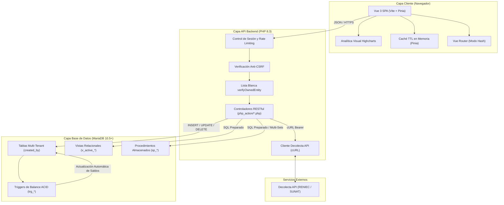
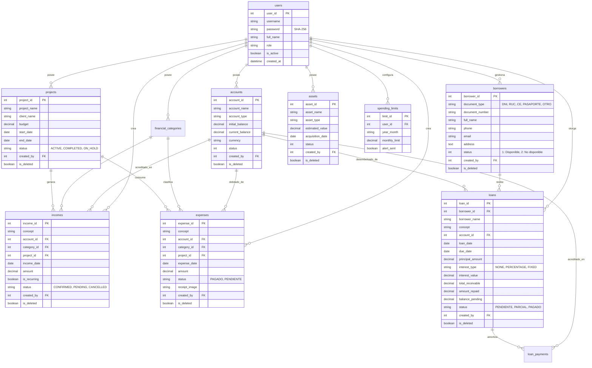

# Reporte de Diseño del Proyecto (PDR)
## myFin — Sistema de Gestión de Finanzas Personales y Patrimonio

<p align="left">
  <strong>🌐 Language / Idioma:</strong>
  <a href="PDR.md">English</a> |
  <strong>Español</strong>
</p>

**Versión del Documento:** 2.0.0  
**Estado:** Aprobado / Listo para Producción  
**Arquitectura:** Aplicación de Página Única (SPA) Multi-Inquilino Moderna  
**Entorno de Ejecución:** PHP 8.1+ / MariaDB 10.5+ / Vue 3 / Vite 8 / Pinia  

---

## 1. Resumen Ejecutivo y Visión del Sistema

### 1.1 Desafío Operativo
Históricamente, el seguimiento de finanzas personales se ha gestionado mediante hojas de cálculo aisladas (Excel, Google Sheets) o sistemas de escritorio heredados. Este enfoque adolece de problemas estructurales críticos:
- **Desincronización de Saldos:** Modificaciones manuales entre efectivo, transferencias bancarias y listas de deudores provocan descuadres recurrentes en la conciliación.
- **Ausencia de Seguridad Multi-Inquilino:** Las hojas de cálculo no pueden garantizar aislamiento de datos entre múltiples usuarios, control de accesos ni cifrado de credenciales.
- **Carencia de Validación de Identidad:** La anotación manual de deudores induce errores tipográficos, falta de números de documento y datos fiscales no verificados.
- **Reportes Estáticos:** Las hojas de cálculo carecen de analítica multidimensional interactiva, alertas de cuota de gasto mensual (al estilo de presupuestos en la nube) y visión consolidada multicuenta.

### 1.2 Visión y Objetivos del Sistema
**myFin** es una plataforma de finanzas personales y gestión patrimonial diseñada para sustituir las hojas de cálculo por una solución web automatizada, transaccional y lista para entornos en producción. Sus objetivos clave de diseño comprenden:
1. **Consistencia Matemática mediante Triggers de Base de Datos:** Eliminación de errores de doble escritura en la aplicación delegando el cálculo de saldos directamente a disparadores ACID en MariaDB.
2. **Experiencia de Usuario SPA Moderna:** Frontend fluido y reactivo con Vue 3, Vite y Pinia integrado en un host ligero de Bootstrap 3, con transiciones suaves, paginación dinámica y modales estáticos que previenen la pérdida accidental de datos.
3. **Aislamiento Multi-Inquilino:** Partición de datos nativa donde cada usuario gestiona exclusivamente sus propias cuentas, gastos, ingresos, préstamos, activos y proyectos.
4. **Verificación de Identidad con Decolecta API:** Integración directa para consultar y autocompletar en un solo clic datos oficiales de DNI (RENIEC) y RUC (SUNAT) de prestatarios.
5. **Analítica Ejecutiva Interactiva con Highcharts:** Gráfico de barras comparativo de 12 meses con filtros multidimensionales (Año, Mes, Categoría) y desglose granular inmediato al pulsar sobre cualquier barra.

---

## 2. Arquitectura de Alto Nivel del Sistema

La solución adopta un modelo de **Aplicación de Página Única (SPA) Híbrida**:
- **Host / Contenedor Base:** `app.php` actúa como el cascarón autenticado, inyectando la sesión del usuario, colecciones iniciales para desplegables y el token de seguridad CSRF en el contexto global de la ventana (`window`).
- **Capa Frontend SPA:** Construida en **Vue 3** (Composition API, `<script setup>`), empaquetada con **Vite**, gestionada con **Pinia** con caché cliente por TTL y navegada mediante **Vue Router** en modo hash.
- **Capa API Backend:** Endpoints RESTful en JSON ubicados en `php_action/`, blindados con validación rigurosa de entradas, verificación de tokens CSRF, listas blancas de pertenencia de entidades y sentencias preparadas.
- **Motor de Base de Datos:** MariaDB/MySQL ejecutando la lógica transaccional mediante procedimientos almacenados (`sp_*`), vistas analíticas (`v_*`) y disparadores ACID (`trg_*`).



---

## 3. Arquitectura de Base de Datos y Modelo de Datos

### 3.1 Diagrama Entidad-Relación (Mermaid)



### 3.2 Invariantes de Consistencia y Motores de Datos

#### 1. Consistencia en Tiempo Real mediante Triggers ACID
Para evitar descuadres o discrepancias entre la lógica PHP y la base de datos, todas las operaciones financieras delegan los ajustes de saldo a disparadores nativos:
- `trg_incomes_after_insert`: Incrementa `accounts.current_balance` con `NEW.amount` cuando el estado no es `CANCELLED`.
- `trg_incomes_after_update`: Revierte el monto anterior y aplica el nuevo monto o nuevo estado.
- `trg_incomes_after_delete`: Descuenta el monto de la cuenta bancaria correspondiente.
- `trg_expenses_after_insert`: Descuenta `NEW.amount` de `accounts.current_balance`.
- `trg_expenses_after_update` / `trg_expenses_after_delete`: Ajusta y concilia el saldo de la cuenta.
- `trg_loans_after_insert`: Descuenta `NEW.principal_amount` de la cuenta de desembolso.
- `trg_loan_payments_after_insert`: Acredita el dinero en la cuenta destino y actualiza `loans.amount_repaid` y `loans.balance_pending`.
- `trg_users_after_insert`: Inicializa automáticamente cuentas bancarias por defecto (*Efectivo*, *BCP*, *BBVA*, *Interbank*, *Yape*, *Plin*) y categorías financieras esenciales tras el registro de cada usuario.

#### 2. Aislamiento Multi-Inquilino a Nivel de Fila
Cada tabla almacena `created_by` con clave foránea a `users.user_id`. Todas las consultas sin excepción filtran por `WHERE created_by = ? AND is_deleted = 0`. El validador `verifyOwnedEntity(connect, table, pkColumn, id, userId)` verifica que cualquier entidad modificada pertenezca estrictamente al usuario en sesión.

#### 3. Paradigma de Eliminación Lógica (Soft Delete)
Las entidades no se borran físicamente para salvaguardar el historial contable y la trazabilidad de proyectos:
- `is_deleted TINYINT(1) DEFAULT 0`
- `deleted_at DATETIME NULL`

---

## 4. Seguridad, Privacidad y Mitigación de Amenazas

| Dominio | Implementación | Amenaza Mitigada |
| :--- | :--- | :--- |
| **Autenticación** | Hashing de contraseña con SHA-256 y protección de intentos (*Rate Limiting*) bloqueando tras 5 fallos durante 15 min. | Ataques de diccionario, fuerza bruta. |
| **Defensa Anti-CSRF** | Token criptográfico único por sesión (`$_SESSION['csrf_token']`), validado en cada petición `POST` e inyectado en cabeceras Axios (`X-CSRF-Token`). | Falsificación de Peticiones en Sitios Cruzados (CSRF). |
| **Inyección SQL** | Consultas preparadas parametrizadas (`mysqli::prepare()`) en el 100% de endpoints. Lista blanca estricta de tablas en `verifyOwnedEntity`. | Inyección SQL (SQLi). |
| **Prevención de XSS** | Limpieza de datos (`cleanInput()`), codificación HTML (`htmlspecialchars()`) y escape automático en plantillas de Vue. | XSS Almacenado y Reflejado. |
| **Protección de Sesión**| Cookies marcadas con `HttpOnly`, `SameSite=Lax` y `Secure` (en HTTPS). Regeneración de identificador de sesión al ingresar. | Secuestro de sesión (*session hijacking*). |
| **Blindaje de Modales** | Modales configurados con `backdrop="static"` y `keyboard="false"`. No se cierran por clics involuntarios fuera de la ventana. | Pérdida de datos mientras se llena un formulario. |

---

## 5. Aplicación de Página Única (SPA) en Vue 3

### 5.1 Estructura del Código Fuente
El código fuente de la SPA reside en `/spa/src` y se compila hacia `/spa/dist`:

```
spa/
├── src/
│   ├── api/
│   │   ├── http.js                  # Instancia Axios con interceptores CSRF y resolución de URL base
│   │   └── index.js                 # Métodos de llamada a los endpoints API
│   ├── components/
│   │   ├── forms/
│   │   │   ├── AccountForm.vue      # Formulario de cuentas bancarias y billeteras
│   │   │   ├── AssetForm.vue        # Formulario de valoración de activos
│   │   │   ├── BorrowerForm.vue     # Formulario de prestatarios con consulta Decolecta
│   │   │   ├── ExpenseForm.vue      # Formulario de gastos con subida de comprobantes
│   │   │   ├── FinCategoryForm.vue  # Formulario de categorías de ingresos y egresos
│   │   │   ├── IncomeForm.vue       # Formulario de ingresos
│   │   │   ├── LoanForm.vue         # Formulario de préstamos con selector de prestatarios
│   │   │   ├── PaymentForm.vue      # Formulario de amortizaciones de préstamos
│   │   │   └── ProjectForm.vue      # Formulario de presupuestos de proyectos
│   │   ├── AppModal.vue             # Componente modal blindado con fondo estático
│   │   ├── AppPagination.vue        # Componente de paginación reactiva
│   │   ├── AppToast.vue             # Sistema de notificaciones toast
│   │   ├── DataTable.vue            # Tabla con buscador y paginación integrada
│   │   ├── FinancialBarChart.vue    # Gráfico Highcharts de 12 meses con desglose granular
│   │   └── ImportModal.vue          # Modal de importación masiva por CSV
│   ├── stores/
│   │   ├── cache.js                 # Caché en memoria con TTL e invalidación dirigida
│   │   ├── useAccountStore.js       # Store de cuentas
│   │   ├── useAssetStore.js         # Store de activos
│   │   ├── useBorrowerStore.js      # Store de prestatarios
│   │   ├── useDashboardStore.js     # Store de métricas del dashboard y calendario
│   │   ├── useExpenseStore.js       # Store de gastos
│   │   ├── useFinCategoryStore.js   # Store de categorías
│   │   ├── useFormOptionsStore.js   # Store de opciones para desplegables de formularios
│   │   ├── useIncomeStore.js        # Store de ingresos
│   │   ├── useLoanStore.js          # Store de préstamos
│   │   ├── useProjectStore.js       # Store de proyectos
│   │   └── useReportStore.js        # Store de reportes financieros
│   ├── views/
│   │   ├── AccountsView.vue         # Vista unificada de Cuentas y Categorías
│   │   ├── AssetsView.vue           # Vista de Patrimonio y Activos físicos
│   │   ├── DashboardView.vue        # Vista del Dashboard ejecutivo y calendario
│   │   ├── ExpenseView.vue          # Vista de Gastos
│   │   ├── IncomeView.vue           # Vista de Ingresos
│   │   ├── LoansView.vue            # Vista con pestañas de Préstamos y Prestatarios
│   │   ├── ProjectsView.vue         # Vista de Proyectos
│   │   ├── ReportsView.vue          # Vista de Reportes Financieros y Highcharts
│   │   └── SettingsView.vue         # Vista de Límites de gasto y perfil
│   ├── App.vue                      # Componente raíz con transiciones y proveedor de toasts
│   ├── main.js                      # Inicialización de Vue, Pinia y Router
│   └── router/
│       └── index.js                 # Definición de rutas en modo hash
```

### 5.2 Rendimiento y Estrategia de Caché
- **Caché en Memoria por TTL:** `cache.js` retiene las respuestas de las tablas en memoria para eliminar peticiones repetitivas al navegar entre pantallas.
- **Invalidación por Mutación:** Al crear, editar o eliminar registros, las stores asociadas invalidan su caché automáticamente (e.g. `loanStore.invalidate()`, `dashboardStore.invalidate()`, `accountStore.invalidate()`), refrescando la información en segundo plano sin bloquear la interfaz.
- **División de Código (Code-Splitting):** Las dependencias pesadas como Highcharts se empaquetan en módulos independientes (`ReportsView-[hash].js`), permitiendo que el paquete inicial de la SPA sea muy ligero (~20 KB).

---

## 6. Integraciones Externas y Analítica Avanzada

### 6.1 Decolecta API (Verificación de Identidad RENIEC / SUNAT)
- **Controlador Proxy:** `php_action/lookupDecolecta.php`
- **Variables de Entorno:** `DECOLECTA_API_TOKEN` y `DECOLECTA_API_URL` configuradas en `.env`.
- **Flujo de Peticiones:**
  - **Consulta DNI:** Despacha `GET /v1/reniec/dni?numero={dni}` con cabecera Bearer. Extrae y concatena nombres y apellidos de la base oficial de RENIEC.
  - **Consulta RUC:** Despacha `GET /v1/sunat/ruc?numero={ruc}`. Obtiene la razón social de la empresa, condición tributaria y domicilio fiscal completo.
- **Puntos de Integración:** Presente en `BorrowerForm.vue` (con botón de búsqueda e indicador spinner) y en `LoanForm.vue` (permitiendo registrar prestatarios al instante sin cerrar el formulario de préstamo).

### 6.2 Motor Comparativo Highcharts y Desglose Granular
- **Componente:** `spa/src/components/FinancialBarChart.vue`
- **Endpoint:** `php_action/getReportsChartData.php`
- **Especificaciones del Gráfico:**
  - Gráfico de Columnas Agrupadas de 12 Meses comparando:
    1. <span style="color:#3498db;font-weight:bold;">Ingresos</span> (`#3498db`)
    2. <span style="color:#5b2c6f;font-weight:bold;">Gastos</span> (`#5b2c6f`)
    3. <span style="color:#2ecc71;font-weight:bold;">Préstamos</span> (`#2ecc71`)
    4. <span style="color:#e67e22;font-weight:bold;">Proyectos</span> (`#e67e22`)
  - **Filtros Multidimensionales:**
    - Filtro por Año (desplegable generado dinámicamente con los años con transacciones).
    - Filtro por Mes (`Todos los meses` o enfoque en un mes determinado).
    - Botones de activación interactiva para encender o apagar series del gráfico en tiempo real.
  - **Filtro Granular al Clic (Drilldown):**
    - Al hacer clic en cualquier barra mensual se dispara `onBarClick(mes, categoria)`.
    - Se activa el banner del filtro granular, se calcula la distribución por tipo de actividad con barras de progreso de participación porcentual y se presenta la tabla de transacciones detalladas con paginación y buscador.

---

## 7. Aseguramiento de Calidad y Pruebas

El sistema cuenta con validación integral en:
- **Sintaxis y Ejecución PHP:** Verificado con `php -l` y pruebas CLI simulando sesiones completas y peticiones cURL.
- **Compilador Vite:** Paquete de producción compilado sin errores con Vite 8.
- **Consistencia de Base de Datos:** Verificación de disparadores, procedimientos almacenados y vistas relacionales.
- **Flujo de Autenticación de Extremo a Extremo:** Probado mediante cURL con cookies de sesión, tokens CSRF y respuestas JSON del API.

---

## 8. Guía Operativa de Despliegue, Respaldos y Mantenimiento

### 8.1 Respaldo de la Base de Datos
Generar un volcado de la base de datos incluyendo disparadores y procedimientos:
```bash
mysqldump -u <DB_USER> -p<DB_PASS> --routines --triggers personal_finance > respaldo_$(date +%F).sql
```

### 8.2 Restauración de la Base de Datos
```bash
mysql -u <DB_USER> -p<DB_PASS> personal_finance < archivo_respaldo.sql
```

### 8.3 Recompilación del Frontend
Al realizar modificaciones en los componentes Vue:
```bash
cd spa
npm install
npm run build
```
Los archivos compilados se ubican en `/spa/dist` y son consumidos automáticamente por `app.php`.
