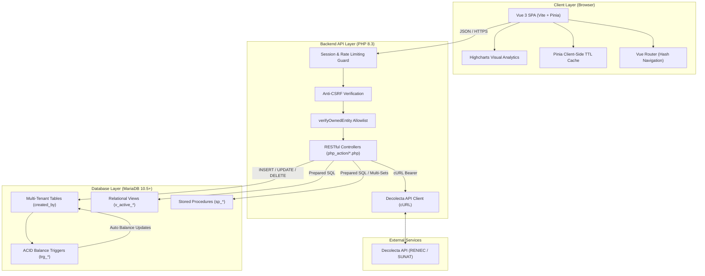
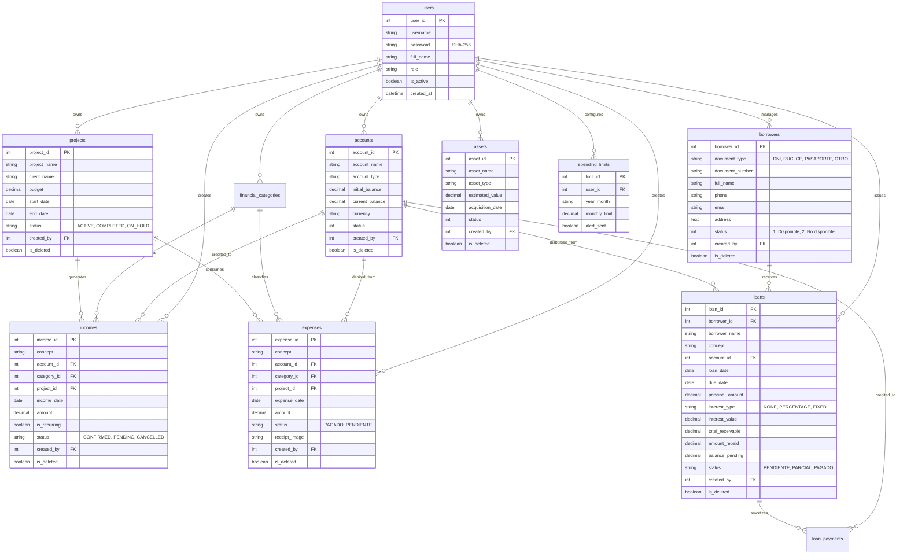

# Project Design Report (PDR)
## myFin — Personal Finance & Wealth Management System

<p align="left">
  <strong>🌐 Language / Idioma:</strong>
  <strong>English</strong> |
  <a href="PDR.es.md">Español</a>
</p>

**Document Version:** 2.0.0  
**Status:** Approved / Production Ready  
**Architecture:** Modern Multi-Tenant Single-Page Application (SPA)  
**Target Environment:** PHP 8.1+ / MariaDB 10.5+ / Vue 3 / Vite 8 / Pinia  

---

## 1. Executive Summary & System Vision

### 1.1 Business Challenge
Historically, individual financial tracking has relied on disparate spreadsheets (Excel, Google Sheets) or legacy desktop tools. These approaches suffer from fundamental structural limitations:
- **Prone to Desynchronization:** Manual updates to cash balances, bank transfers, and debtor spreadsheets lead to reconciliation discrepancies.
- **Lack of Multi-Tenant Security:** Spreadsheets cannot provide role-based access control, encryption, or multi-user data isolation.
- **Absence of Identity Verification:** Recording loans and debtor information manually introduces typographical errors and unverified identity records.
- **Static Reporting:** Spreadsheets lack interactive multi-dimensional drilldown analytics, quota alerts (e.g., cloud-style spending thresholds), and unified cross-account tracking.

### 1.2 System Vision & Objectives
**myFin** is an enterprise-grade personal wealth and financial management platform engineered to replace spreadsheet tracking with an automated, transactional, and cloud-ready web application. Key design objectives include:
1. **Mathematical Consistency via Database Triggers:** Elimination of dual-write application bugs by delegating account balance updates directly to MariaDB ACID triggers.
2. **Modern Single-Page Application (SPA) UX:** Seamless Vue 3 + Vite + Pinia frontend loaded in a lightweight Bootstrap 3 host, offering zero full-page reload lag, dynamic pagination, and static modal defense against accidental closure.
3. **Multi-Tenant Data Isolation:** Native multi-user partitioning where each user securely manages their independent accounts, expenses, incomes, loans, assets, and projects.
4. **Third-Party Identity Integration (Decolecta API):** Automated DNI (RENIEC) and RUC (SUNAT) validation and auto-population for borrower records.
5. **Interactive Executive Analytics (Highcharts):** 12-month grouped comparative bar chart with multi-dimensional filtering (Year, Month, Category) and granular drilldown breakdown on bar click.

---

## 2. High-Level System Architecture

The application adopts a **Hybrid Single-Page Application (SPA)** model:
- **Host / Bootstrapper:** `app.php` acts as the authenticated shell container, injecting session state, initial dropdown collections, and CSRF security tokens into the window context.
- **Frontend SPA Layer:** Built with **Vue 3** (Composition API, `<script setup>`), bundled by **Vite**, managed by **Pinia** with client-side TTL caching, and routed via **Vue Router** hash mode.
- **Backend API & Controller Proxy:** RESTful JSON PHP endpoints residing in `php_action/`, secured by strict input sanitization, CSRF verification, ownership allowlists, and prepared statements.
- **Database Engine:** MariaDB/MySQL executing transactional business logic, stored procedures (`sp_*`), optimized database views (`v_*`), and real-time audit triggers (`trg_*`).



---

## 3. Database Architecture & Data Model

### 3.1 Entity-Relationship Model (Mermaid)



### 3.2 Key Database Engines & Consistency Invariants

#### 1. Real-Time Account Balance Triggers
To prevent double-counting or discrepancies between PHP controller logic and database state, all financial transactions execute balance adjustments via ACID database triggers:
- `trg_incomes_after_insert`: Increments `accounts.current_balance` by `NEW.amount` when `status != 'CANCELLED'`.
- `trg_incomes_after_update`: Reverses old amount and applies new amount or cancellation status.
- `trg_incomes_after_delete`: Deducts amount from the associated account.
- `trg_expenses_after_insert`: Deducts `NEW.amount` from `accounts.current_balance`.
- `trg_expenses_after_update` / `trg_expenses_after_delete`: Corrects and adjusts account balance.
- `trg_loans_after_insert`: Deducts `NEW.principal_amount` from the disbursement account.
- `trg_loan_payments_after_insert`: Increments destination account balance and updates `loans.amount_repaid` and `loans.balance_pending`.
- `trg_users_after_insert`: Automatically seeds default financial accounts (*Efectivo*, *BCP*, *BBVA*, *Interbank*, *Yape*, *Plin*) and essential financial categories upon user registration.

#### 2. Multi-Tenant Row-Level Isolation
Every table references `users.user_id` via `created_by`. All SQL queries enforce `WHERE created_by = ? AND is_deleted = 0`. Server-side validation helper `verifyOwnedEntity(connect, table, pkColumn, id, userId)` validates that any mutated entity strictly belongs to the logged-in session user.

#### 3. Soft Delete Paradigm
Entities are logically deleted rather than physically removed:
- `is_deleted TINYINT(1) DEFAULT 0`
- `deleted_at DATETIME NULL`
This guarantees full audit capability, preserves historical references for project profitability, and maintains foreign key referential integrity.

---

## 4. Security, Privacy & Threat Mitigation

| Security Domain | Implementation | Threat Mitigated |
| :--- | :--- | :--- |
| **Authentication** | SHA-256 password hashing with rate-limited brute force protection (lockout after 5 attempts for 15 min). | Credential stuffing, dictionary attacks. |
| **CSRF Defense** | Cryptographic token generated per session (`$_SESSION['csrf_token']`), verified on all `POST` requests and injected into Axios headers (`X-CSRF-Token`). | Cross-Site Request Forgery (CSRF). |
| **SQL Injection** | Strict parameterized queries (`mysqli::prepare()`) across 100% of endpoints. Strict table/column allowlist in `verifyOwnedEntity`. | SQL Injection (SQLi). |
| **XSS Prevention** | Server-side sanitization (`cleanInput`), HTML entity encoding (`htmlspecialchars`), and Vue template automatic string escaping. | Stored and Reflected XSS. |
| **Session Protection** | Cookies marked with `HttpOnly`, `SameSite=Lax`, and `Secure` (when HTTPS active). Session fixation regeneration upon login. | Session hijacking, cookie theft. |
| **Multi-Tenant Leakage** | All database statements mandate `created_by = ?` filter. Session ID is taken exclusively from server-side PHP session. | Insecure Direct Object References (IDOR). |
| **Static Modals Defense** | Vue modals configured with `backdrop="static"` and `keyboard="false"`. Dialogs only close on deliberate action buttons. | Accidental data loss during form entry. |

---

## 5. Frontend Single-Page Application (SPA)

### 5.1 Architecture & Directory Organization
The SPA is structured under `/spa/src` and compiled into optimized assets located in `/spa/dist`:

```
spa/
├── src/
│   ├── api/
│   │   ├── http.js                  # Axios instance with CSRF interceptors & base URL resolution
│   │   └── index.js                 # Centralized API service functions
│   ├── components/
│   │   ├── forms/
│   │   │   ├── AccountForm.vue      # Bank / wallet account registration & editing
│   │   │   ├── AssetForm.vue        # Asset valuation form
│   │   │   ├── BorrowerForm.vue     # Prestatario form with Decolecta DNI/RUC query
│   │   │   ├── ExpenseForm.vue      # Expense entry with receipt file upload
│   │   │   ├── FinCategoryForm.vue  # Income/expense category form
│   │   │   ├── IncomeForm.vue       # Income stream form
│   │   │   ├── LoanForm.vue         # Loan disbursement form with borrower selector
│   │   │   ├── PaymentForm.vue      # Loan repayment amortization form
│   │   │   └── ProjectForm.vue      # Project budget & client form
│   │   ├── AppModal.vue             # Modal wrapper with static backdrop defense
│   │   ├── AppPagination.vue        # Reusable client-side pagination component
│   │   ├── AppToast.vue             # Toast notifications system
│   │   ├── DataTable.vue            # Reusable responsive search & paginated table
│   │   ├── FinancialBarChart.vue    # Highcharts 12-month grouped bar chart & drilldown
│   │   └── ImportModal.vue          # CSV bulk import modal
│   ├── stores/
│   │   ├── cache.js                 # In-memory TTL client cache with invalidation hooks
│   │   ├── useAccountStore.js       # Accounts Pinia store
│   │   ├── useAssetStore.js         # Assets Pinia store
│   │   ├── useBorrowerStore.js      # Borrowers Pinia store
│   │   ├── useDashboardStore.js     # Dashboard metrics & calendar Pinia store
│   │   ├── useExpenseStore.js       # Expenses Pinia store
│   │   ├── useFinCategoryStore.js   # Categories Pinia store
│   │   ├── useFormOptionsStore.js   # Centralized dropdown options store
│   │   ├── useIncomeStore.js        # Incomes Pinia store
│   │   ├── useLoanStore.js          # Loans Pinia store
│   │   ├── useProjectStore.js       # Projects Pinia store
│   │   └── useReportStore.js        # Financial reports Pinia store
│   ├── views/
│   │   ├── AccountsView.vue         # Accounts & Categories unified view
│   │   ├── AssetsView.vue           # Wealth & physical assets view
│   │   ├── DashboardView.vue        # Executive dashboard & interactive calendar
│   │   ├── ExpenseView.vue          # Expenses management view
│   │   ├── IncomeView.vue           # Income management view
│   │   ├── LoansView.vue            # Loans & Borrowers tabbed management view
│   │   ├── ProjectsView.vue         # Projects management view
│   │   ├── ReportsView.vue          # Executive reports & Highcharts comparative view
│   │   └── SettingsView.vue         # Spending limits & profile view
│   ├── App.vue                      # Root SPA component with page transitions & toast provider
│   ├── main.js                      # Application bootstrap & Pinia/Router registration
│   └── router/
│       └── index.js                 # Vue Router hash-mode route definitions
```

### 5.2 Performance & Caching Strategy
- **Client-Side In-Memory Cache:** `cache.js` provides lightweight memory caching for table lists with TTL expiry.
- **Mutation-Driven Cache Invalidation:** When a creation, update, or deletion occurs, relevant store caches (e.g. `loanStore.invalidate()`, `dashboardStore.invalidate()`, `accountStore.invalidate()`) are automatically purged, triggering an instantaneous and non-blocking background reload.
- **Lazy Code-Splitting:** Heavy analytic dependencies (such as Highcharts) are compiled into standalone chunks (`ReportsView-[hash].js`), ensuring that initial page loads remain lightweight (~20 KB initial JS).

---

## 6. External Integrations & Advanced Features

### 6.1 Decolecta API (RENIEC / SUNAT Identity Verification)
- **API Proxy:** `php_action/lookupDecolecta.php`
- **Environment Credentials:** `DECOLECTA_API_TOKEN` and `DECOLECTA_API_URL` configured in `.env`.
- **Query Flow:**
  - **DNI Lookup:** Dispatches `GET /v1/reniec/dni?numero={dni}` with Bearer authorization. Automatically extracts and concatenates `first_name`, `first_last_name`, and `second_last_name`.
  - **RUC Lookup:** Dispatches `GET /v1/sunat/ruc?numero={ruc}`. Automatically resolves company trade name (`razon_social`), tax condition, and full street address.
- **Integration Points:** Integrated into `BorrowerForm.vue` (with instant feedback and search spinner) and `LoanForm.vue` (enabling on-the-fly borrower registration without losing loan draft data).

### 6.2 Highcharts Comparative Financial Engine & Granular Drilldown
- **Component:** `spa/src/components/FinancialBarChart.vue`
- **Endpoint:** `php_action/getReportsChartData.php`
- **Chart Specifications:**
  - 12-Month Grouped Column Bar Chart comparing:
    1. <span style="color:#3498db;font-weight:bold;">Ingresos</span> (`#3498db`)
    2. <span style="color:#5b2c6f;font-weight:bold;">Gastos</span> (`#5b2c6f`)
    3. <span style="color:#2ecc71;font-weight:bold;">Préstamos</span> (`#2ecc71`)
    4. <span style="color:#e67e22;font-weight:bold;">Proyectos</span> (`#e67e22`)
  - **Multi-Dimensional Filters:**
    - Filter by Year (dynamic dropdown populated from transaction history).
    - Filter by Month (`Todos los meses` or individual month focus).
    - Category visibility toggle pills (instant client-side series toggle).
  - **Granular Filter (Drilldown on Click):**
    - Clicking any monthly bar triggers `onBarClick(month, category)`.
    - Activates granular filter banner, reveals activity-type distribution breakdown with percentage share progress bars, and loads a paginated, searchable transaction table.

---

## 7. Quality Assurance & Automated Verification

The application maintains zero-defect status across:
- **PHP Syntax & Runtime:** Validated with `php -l` and automated CLI end-to-end simulation scripts.
- **Vite Production Bundler:** Production build verified with Rolldown/Vite with zero bundling errors.
- **Database Consistency:** Schema validation via automated trigger and procedure verification routines.
- **Full-Stack Authentication Flow:** Verified end-to-end via authenticated cURL session runs testing login, CSRF tokens, SPA shell delivery, and JSON API payloads.

---

## 8. Deployment, Backup & Maintenance Runbook

### 8.1 Database Backup
Execute database backups containing routines and triggers:
```bash
mysqldump -u <DB_USER> -p<DB_PASS> --routines --triggers personal_finance > backup_$(date +%F).sql
```

### 8.2 Database Restore
```bash
mysql -u <DB_USER> -p<DB_PASS> personal_finance < backup_file.sql
```

### 8.3 Frontend Recompilation
When modifying Vue components:
```bash
cd spa
npm install
npm run build
```
Compiled bundles are automatically deployed to `/spa/dist` and linked by `app.php`.
